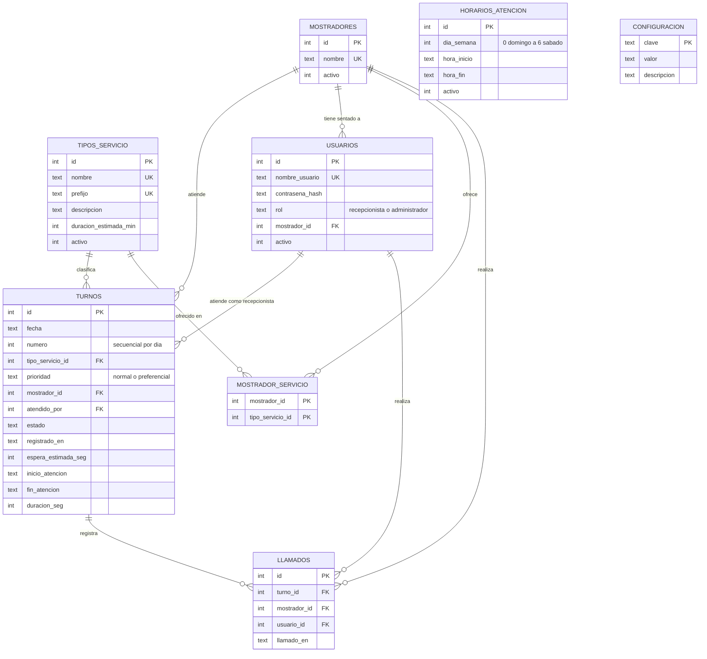

# Modelo de datos

Issue: GES-6 · Base de datos: SQLite · Script: `database/schema.sql`

## Diagrama entidad-relación

## Estados de un turno

| Estado | Significado | Cómo se llega |
|---|---|---|
| `esperando` | El cliente tomó turno y espera | RF-01 |
| `en_atencion` | El recepcionista lo llamó | RF-04 |
| `atendido` | Terminó la atención | RF-05 |
| `no_asistio` | No respondió tras el máximo de llamados | RF-06 |
| `cancelado` | El cliente canceló su turno | RF-03 |

Transiciones permitidas:

- `esperando` → `en_atencion` → `atendido`
- `esperando` → `cancelado`
- `en_atencion` → `no_asistio` (cuando los llamados llegan a `max_llamados`)

## Orden de la fila

Al llamar al siguiente turno se toma el primer turno en estado `esperando`, ordenado así:

1. Primero los de prioridad `preferencial`.
2. Dentro de la misma prioridad, por orden de llegada (`numero`).
3. Solo turnos de tipos de servicio que el mostrador del recepcionista atiende (`mostrador_servicio`).

## Reglas del modelo

- **Sin datos personales:** no se guarda nombre, teléfono ni correo del cliente (NFR-04). El cliente solo tiene un número de turno.
- **Número de turno:** es secuencial por día (el par `fecha` y `numero` es único) y se muestra con el prefijo del servicio, por ejemplo `T-012`. Al crear un turno, calcular `MAX(numero) + 1` de esa fecha dentro de una transacción.
- **Prioridad:** `normal` por defecto. Los turnos `preferencial` pasan primero en la fila.
- **Mostrador del recepcionista:** `usuarios.mostrador_id` indica en qué mostrador está sentado. Así el sistema sabe desde dónde se llama cada turno (RF-04, RF-07).
- **Vínculo turno-mostrador (RF-07):** `turnos.mostrador_id` queda vacío mientras el turno espera y se llena cuando el recepcionista lo llama.
- **Llamados (RF-06):** cada llamado es una fila en `llamados`. El número de llamados de un turno es la cantidad de filas, y queda la evidencia de cada intento.
- **Configuración:** parámetros como `max_llamados` y los de la estimación viven en la tabla `configuracion`, no dentro del código. Quedan documentados y se pueden cambiar sin tocar el programa (NFR-08).
- **Espera estimada:** `espera_estimada_seg` guarda lo que se le mostró al cliente. Comparada con la espera real (`inicio_atencion` menos `registrado_en`) permite medir qué tan acertada fue la estimación, y la estimación no se presenta como certeza (NFR-08).
- **Duración (RF-05):** al marcar `atendido` se guarda `fin_atencion` y `duracion_seg`. Esos datos alimentan los reportes (RF-09) y la estimación (RF-10).
- **Contraseñas (NFR-04):** solo se guarda el hash, nunca texto plano.
- **Borrado lógico:** servicios, mostradores y usuarios se desactivan con `activo = 0`, no se borran, para no romper el historial de turnos.

## Qué usa cada requerimiento

| Requerimiento | Tablas |
|---|---|
| RF-01, RF-02, RF-03 | `turnos`, `tipos_servicio` |
| RF-04 | `turnos`, `mostradores`, `usuarios`, `llamados`, `mostrador_servicio` |
| RF-05 | `turnos` |
| RF-06 | `llamados`, `turnos`, `configuracion` |
| RF-07 | `mostradores`, `tipos_servicio`, `mostrador_servicio`, `turnos`, `usuarios` |
| RF-08 | `tipos_servicio`, `mostradores`, `horarios_atencion` |
| RF-09 | `turnos`, `tipos_servicio` |
| RF-10, NFR-08 | `turnos` (`espera_estimada_seg` y tiempos), `tipos_servicio`, `configuracion` |
| NFR-04 | `usuarios` |