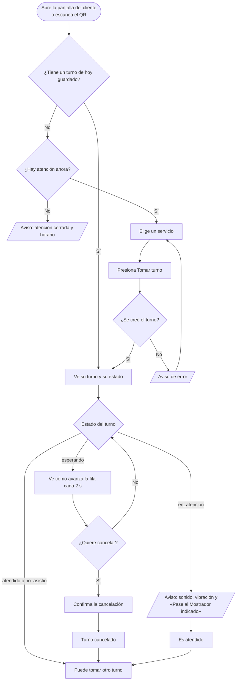
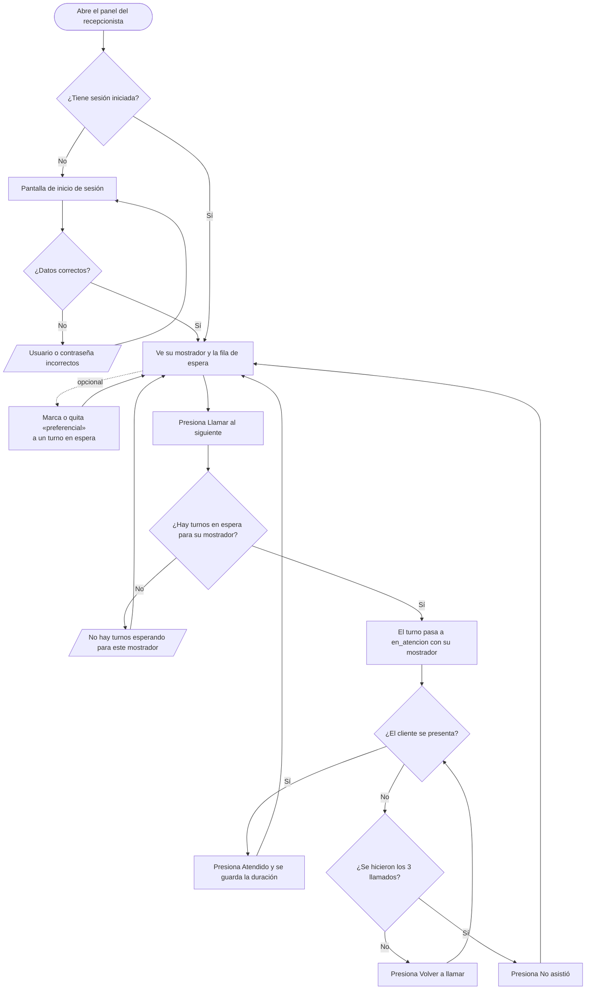

# Propuesta de experiencia de usuario (UX)

Issue: GES-42 · Responsable: Daniel Ortiz · Propuesta: 2026-10-20 · Estado actualizado el 24 de octubre de 2026 para reflejar el código actual

Este documento propone cómo debe sentirse y comportarse el sistema para quienes lo usan: el cliente que toma turno y el recepcionista que lo atiende. Cubre los cinco aspectos que pide el curso: **claridad del flujo, facilidad de uso, consistencia, accesibilidad y retroalimentación al usuario**.

Junto a cada propuesta se indica si ya está implementada y, cuando la implementación se apartó de la propuesta, en qué.

Documentos relacionados: [historias de usuario y criterios de aceptación](../specs/001-client-queue-flow/spec.md) · [modelo de datos](modelo-de-datos.md) · [componentes](componentes.md) · estilos compartidos en [`estilos.css`](../src/public/css/estilos.css).

## 1. Usuarios y qué necesitan

| Usuario | Contexto de uso | Qué necesita | Principio de diseño |
|---|---|---|---|
| **Cliente** | Llega sin cuenta, normalmente desde su celular (puede escanear el código QR del local) o una pantalla del local. Puede tener poca experiencia con tecnología. | Tomar turno rápido (menos de 30 s, NFR-01), saber cuándo le toca y poder cancelar. | Pocas decisiones, textos claros, nada que aprender. |
| **Recepcionista** | Computadora en su mostrador, uso continuo durante horas. | Llamar al siguiente, ver la fila y cerrar cada atención sin errores. | Una acción principal visible, información de la fila siempre a la vista. |
| **Administrador** | Computadora, uso ocasional. | Configurar servicios, mostradores y horarios, ver reportes e imprimir el QR. | Formularios simples y tablas legibles. |

Este documento detalla al cliente y al recepcionista, que son los flujos principales. El panel del administrador (GES-7) usa los mismos componentes visuales: tarjetas, tablas, botones y avisos.

## 2. Principios

1. **Una cosa a la vez.** Cada pantalla tiene una sola acción principal (el botón morado).
2. **El sistema siempre responde.** Toda acción termina en un mensaje que dice qué pasó y qué hacer después.
3. **Sin sorpresas.** Las acciones que no se pueden deshacer (cancelar un turno) piden confirmación.
4. **Sin datos personales.** El cliente nunca escribe su nombre, teléfono ni correo (NFR-04), y la pantalla lo dice.
5. **Que funcione para todos.** Letra grande, alto contraste, botones grandes y mensajes en español sencillo (NFR-01, NFR-03, NFR-07).

## 3. Flujo del cliente

Del momento en que abre la pantalla hasta que ve su turno y es atendido:

**Decisiones de diseño del flujo**

- **Dos acciones para tomar turno:** elegir el servicio y presionar "Tomar turno". No hay registro, ni formularios, ni más pantallas.
- **El turno se recuerda.** El navegador guarda el turno del día, así que si el cliente recarga o cierra la pestaña lo vuelve a ver. Al día siguiente empieza limpio.
- **El estado se entiende de un vistazo.** Cada estado del turno tiene un texto propio y un mismo lugar en la pantalla: "Esperando tu turno", "Pase al Mostrador 1", "Tu turno fue cancelado".
- **El cliente se entera aunque no mire la pantalla.** Cuando lo llaman suena una alarma, el celular vibra y el título de la pestaña parpadea con "¡ES TU TURNO!". El aviso se detiene al tocar la pantalla. El navegador solo permite sonido después de que el usuario toca la página; ese permiso se activa con el primer toque, por ejemplo al presionar "Tomar turno".
- **Siempre hay salida.** Cuando el turno termina (atendido, cancelado o no asistió) aparece "Tomar otro turno".

## 4. Flujo del recepcionista

**Decisiones de diseño del flujo**

- **El panel tiene zonas fijas:** a la izquierda "En atención" (lo que está haciendo) y a la derecha "Fila de espera" (lo que viene). Debajo, "Otros mostradores" muestra qué atiende el resto. En pantallas angostas las zonas se apilan.
- **Un solo botón principal a la vez.** Sin turno en atención, el botón principal es "Llamar al siguiente". Con turno en atención, el principal es "Atendido" y "Llamar al siguiente" queda desactivado, para evitar llamar a otro sin cerrar el actual.
- **El orden de la fila lo decide el sistema**, no la persona: primero los turnos preferenciales, luego por orden de llegada, y solo los servicios que atiende ese mostrador (ver [modelo de datos](modelo-de-datos.md)). El recepcionista solo puede marcar o quitar la prioridad preferencial de un turno en espera.
- **"No asistió" lo confirma el recepcionista.** El botón se habilita cuando se completan los llamados configurados (3 por defecto), y la nota explica cuántos faltan.
- **La fila se actualiza sola** cada 2 segundos.
- **El contador de llamados es visible** ("Llamados: 1 de 3") junto con la regla de qué pasa al llegar al máximo.
- **El recepcionista queda fijado a su mostrador.** Si inicia sesión con un usuario asignado a un mostrador, el selector se bloquea. El administrador puede cambiar de mostrador.

## 5. Wireframes

Los wireframes están en baja fidelidad (estructura y mensajes, no color final). Las imágenes están en la carpeta [`Ux evidencia/`](Ux%20evidencia/). El número morado de cada imagen se explica en las leyendas de abajo. El archivo editable original de draw.io no está en el repositorio.

### 5.1 Cliente (celular)

**C1 · Elegir servicio** (implementado)
1. Título y subtítulo que explican la pantalla: "Toma tu turno. Sin cuenta y sin dar tus datos."
2. Servicios como tarjetas grandes. El elegido se marca con color, borde y ✓ (no solo con color).
3. Único botón principal. Está desactivado hasta que se elige un servicio.
4. Recordatorio de privacidad: "Tu turno no guarda nombre, teléfono ni correo."

**C2 · Turno creado** (implementado)
1. Número de turno en grande, con el prefijo del servicio (T-012). Si el turno es preferencial, se indica junto al servicio.
2. Estado en texto: "Esperando tu turno".
3. Panel "Estado de la fila", actualizado cada 2 s: quién se atiende ahora, cuántos turnos van antes del tuyo y la espera aproximada (NFR-08).
4. "Cancelar mi turno" como botón secundario, para que no compita con la acción principal.

**C3 · Te están llamando** (implementado)
1. El estado cambia a "Pase al Mostrador 1", resaltado con el color de acento y en letra más grande. Desaparece el botón de cancelar.
2. Agregado en GES-51: alarma sonora, vibración y título de la pestaña parpadeante.

**C4 · Confirmar cancelación** (implementado de forma simplificada, GES-27)
- La propuesta era un diálogo propio con el número del turno y los botones "No, volver" y "Sí, cancelar".
- La implementación usa el diálogo de confirmación del navegador con el texto "¿Deseas cancelar tu turno?" y los botones "Aceptar" y "Cancelar". Cumple el principio de pedir confirmación, pero no muestra el número del turno.

**C5 · Turno cancelado** (implementado, GES-27)
1. Estado en texto: "Tu turno fue cancelado", y un aviso: "Tu turno fue cancelado correctamente."
2. Salida clara: "Tomar otro turno".
3. Diferencia con la propuesta: el número no cambia a gris; el estado final se comunica con el texto.

**C6 · Avisos y errores** (implementado)
1. **A, informativo:** atención cerrada, con el horario.
2. **B, error:** no se pudo tomar el turno, con qué hacer ("Intenta de nuevo") y el botón a la vista para reintentar.
3. **C, informativo:** se perdió la conexión con la fila: "No pudimos actualizar la fila. Seguimos intentando…". Se conservan los últimos datos.

### 5.2 Recepcionista (computadora)

**R1 · Inicio de sesión** (implementado en `login.html`, GES-8 y GES-50)
1. Tarjeta centrada con un solo propósito.
2. Campos con etiqueta visible (no solo texto de ejemplo).
3. Error en un aviso, sin decir cuál de los dos datos falló: "Usuario o contraseña incorrectos."
4. Botón principal "Entrar". Después de entrar, cada usuario va a su pantalla según su rol.

**R2 · Panel sin turno en atención** (implementado, GES-10)
1. Zona "En atención".
2. Estado vacío explícito: "No tienes ningún turno en atención."
3. Único botón principal: "Llamar al siguiente".
4. Fila de espera con el turno, el servicio, la espera de cada uno, la etiqueta "Preferencial" y el botón para marcar o quitar la prioridad. Se actualiza cada 2 s.

**R3 · Panel con turno en atención** (implementado, GES-10 y GES-24)
1. El turno actual con su número en grande.
2. Servicio del turno.
3. Contador "Llamados: 1 de 3" y la regla del "No asistió" en una línea.
4. "Atendido" (principal): cierra la atención y muestra la duración.
5. "Volver a llamar" (secundario): registra otro llamado.
6. "No asistió" (oscuro): se habilita al completar los llamados.

## 6. Facilidad de uso y consistencia

**Facilidad de uso**

| Qué | Cómo se cuida |
|---|---|
| Rapidez | El cliente toma turno en 2 acciones. Meta medible: menos de 30 s (NFR-01). |
| Errores evitables | El botón "Tomar turno" está desactivado hasta elegir servicio; el doble clic crea un solo turno; cancelar pide confirmación; en recepción no se puede llamar a otro turno sin cerrar el actual. |
| Recuperación | Cada error dice qué hacer y deja el botón a la vista para reintentar. |
| Memoria | Nada que recordar: el turno se guarda en el navegador y la pantalla explica "Guarda este número". |
| Pantalla vacía | Los estados vacíos tienen texto ("No hay turnos esperando para este mostrador.", "No tienes ningún turno en atención.", "Nadie por ahora"). |

**Consistencia**

- Todas las pantallas comparten la misma estructura: barra superior con el logo, título de la pantalla, contenido y pie. Está en [`estilos.css`](../src/public/css/estilos.css).
- Un solo color de acento (morado) con un solo significado: lo principal o lo seleccionado.
- Los mismos componentes en todas partes: botones (principal, secundario, oscuro), tarjetas, tablas, etiquetas de estado y avisos.
- Los mismos nombres de estado en toda la interfaz, tomados del modelo de datos: `esperando`, `en_atencion`, `atendido`, `no_asistio`, `cancelado`.
- Mismo tono de voz: tuteo, frases cortas y sin términos técnicos.

## 7. Accesibilidad

Se cuida lo que pide el curso (contraste, tamaño de letra y textos claros) y algunos aspectos más. La columna "Estado" indica si ya está comprobado en el código actual.

| Aspecto | Criterio | Cómo se cumple | Estado |
|---|---|---|---|
| **Contraste** | Mínimo 4.5:1 en texto (WCAG AA). | Texto principal sobre blanco: 17.7:1. Texto secundario: 7.0 a 7.7:1. Blanco sobre morado (botón y número de turno): 7.1:1. Morado oscuro sobre morado suave: 10.0:1. | Calculado |
| **Tamaño de letra** | Base de 18 px o más. | El texto base mide 18 px. Los títulos miden entre 32 y 60 px y el número de turno entre 56 y 96 px, según el ancho de la pantalla. | Implementado |
| **Botones** | Al menos 44 px de alto. | Botones normales de 44 px; el principal de 56 px. Las tarjetas de servicio miden al menos 80 px. | Implementado |
| **No depender del color** | La información no se transmite solo con color. | El servicio elegido lleva ✓ y borde; cada estado tiene su texto; los avisos tienen texto, no solo color. El aviso de llamado también usa sonido y vibración. | Implementado |
| **Textos claros** | Español sencillo, sin códigos técnicos. | Frases cortas, tuteo, y qué hacer en cada error. Ver sección 8. | Implementado |
| **Teclado** | Todo se puede usar sin mouse. | Botones y tarjetas son elementos nativos, y el foco se ve con un contorno morado de 3 px. | Implementado |
| **Lectores de pantalla** | Roles y avisos correctos. | La lista de servicios es un grupo de opciones con estado (`role="radiogroup"`, `aria-checked`); los avisos usan `role="alert"` o `role="status"`; el número de turno se anuncia al cambiar (`aria-live`); las secciones del panel de recepción tienen título asociado (`aria-labelledby`). | Implementado |
| **Pantallas pequeñas** | Funciona en celular sin desplazamiento horizontal. | Diseño responsive. Se comprobó en 320, 360, 768 y 1366 px (capturas en `docs/EvidenciaDeDiferentesDisposivosYNavegadores/`). | Comprobado en Chromium |
| **Navegadores** | Chrome, Firefox y Edge (NFR-07). | Solo HTML, CSS y JavaScript estándar. | Pendiente de probar en Firefox y Edge (GES-18) |
| **Movimiento** | Nada depende de animaciones. | La interfaz no usa animaciones necesarias para entenderla. | Implementado |

Pendiente: el texto de los botones desactivados (gris sobre gris claro, 4.4:1) queda un poco por debajo de 4.5:1. WCAG exime a los controles desactivados, pero conviene oscurecerlo al ajustar la interfaz.

## 8. Mensajes al usuario (retroalimentación)

Todo lo que el usuario hace recibe una respuesta visible. Los textos de la columna "Texto" son los que usa hoy la interfaz.

### Cliente

| Situación | Texto | Tipo |
|---|---|---|
| **Turno creado** | Número grande (por ejemplo `T-012`), "Esperando tu turno" y "Mantén esta pantalla abierta para enterarte cuando te llamen. Guarda este número: si recargas la página, aquí seguirá tu turno." | Resultado en la tarjeta del turno |
| **Te están llamando** | "Pase al Mostrador 1" (si no se sabe el mostrador: "Te están llamando"), con sonido, vibración y "¡ES TU TURNO!" en el título de la pestaña | Resaltado con el acento |
| **Turno atendido** | "Tu turno ya fue atendido" + botón "Tomar otro turno" | Estado final |
| **No asististe** | "Tu turno se marcó como "no asistió"" + botón "Tomar otro turno" | Estado final |
| **Confirmar cancelación** | "¿Deseas cancelar tu turno?" (diálogo del navegador) | Diálogo |
| **Turno cancelado** | "Tu turno fue cancelado" y el aviso "Tu turno fue cancelado correctamente." + botón "Tomar otro turno" | Estado final |
| **No se puede cancelar** | "Este turno ya no se puede cancelar. Actualiza la página para consultar su estado." | Error |
| **Atención cerrada** | "La atención está cerrada en este momento. Horario de hoy: 08:00 a 17:00." (o "Hoy no hay atención.") | Informativo |
| **Sin servicios** | "No hay servicios disponibles por ahora." | Informativo |
| **Error al tomar turno** | "No fue posible tomar el turno. Intenta de nuevo." | Error |
| **Servicio no disponible** | "Ese servicio no está disponible. Elige otro." | Error |
| **Falla al cargar servicios** | "No pudimos cargar los servicios. Revisa tu conexión e intenta de nuevo." | Error |
| **Falla al consultar el turno** | "No pudimos consultar tu turno. Revisa tu conexión e intenta de nuevo." | Error |
| **Sin conexión con la fila** | "No pudimos actualizar la fila. Seguimos intentando…" | Informativo |
| **Nadie en atención** | "Nadie por ahora" | Informativo |
| **Espera estimada** | Al crear el turno: "Tiempo de espera aproximado: 15 minutos." En el panel de la fila: "Aprox. 15 minutos", "Atención próxima" o, si no hay datos, "No disponible por ahora". | Informativo |

### Recepcionista

| Situación | Texto | Tipo |
|---|---|---|
| Datos de acceso incorrectos | "Usuario o contraseña incorrectos" | Error |
| Sin turno en atención | "No tienes ningún turno en atención." | Estado vacío |
| Fila vacía | "No hay turnos esperando para este mostrador." | Informativo |
| Turno llamado | El código del turno en grande y "Llamados: 1 de 3" | Confirmación |
| Faltan llamados | "Si no responde, vuelve a llamar. Faltan 2 llamados para poder marcarlo como "no asistió"." | Informativo |
| Llamados completos | "Se hicieron todos los llamados. Si no responde, márcalo como "no asistió"." | Informativo |
| Turno atendido | "Turno T-012 atendido. Duración: 4 min 12 s." | Confirmación |
| Turno en atención sin cerrar | "Ya tienes un turno en atención. Termínalo antes de llamar al siguiente." | Error |
| Atención cerrada | "La atención está cerrada en este momento. Horario de hoy: …" | Informativo |
| Sin conexión | "Sin conexión con el servidor. Reintentando…" | Informativo |
| Falla de red al actuar | "No se pudo completar la acción. Revisa tu conexión e intenta de nuevo." | Error |

**Reglas de redacción**

- Decir qué pasó y qué hacer después, en una o dos frases.
- Nunca mostrar códigos, nombres de tabla ni textos técnicos del servidor.
- Un error nunca se presenta como éxito: si no se creó el turno, no se muestra ningún número.
- La estimación de espera siempre se presenta como aproximada, nunca como promesa (NFR-08).

## 9. Cómo se validará

Prueba de usabilidad rápida con 3 personas que no conozcan el sistema, usando el celular:

| Tarea | Éxito |
|---|---|
| Tomar un turno de "Trámite". | Lo logran en menos de 30 s y sin ayuda (NFR-01). |
| Recargar la página y decir cuál es su turno. | Encuentran su número sin dudar. |
| Cancelar el turno y tomar uno nuevo. | Lo logran sin ayuda y entienden el mensaje de confirmación. |

Se anota el tiempo, los errores y las frases que no entendieron, y se ajustan los textos.

## 10. Decisiones tomadas

Las decisiones que quedaron pendientes en la propuesta del 20 de octubre se resolvieron así:

1. **Pantalla de inicio de sesión (R1):** es una pantalla propia, `login.html`, compartida por recepcionistas y administradores. `recepcion.html` envía a ella cuando no hay sesión (GES-8 y GES-50).
2. **"No asistió" automático o manual (R3):** es manual. Al completar el máximo de llamados se habilita el botón "No asistió" y el recepcionista lo confirma (GES-10).
3. **Turnos preferenciales:** los marca o desmarca el recepcionista desde la fila de espera, solo mientras el turno está esperando.
4. **Aviso de llamada:** se resolvió en la pantalla del cliente con sonido, vibración y título parpadeante (GES-51). Una pantalla grande para la sala de espera sigue fuera del alcance.
