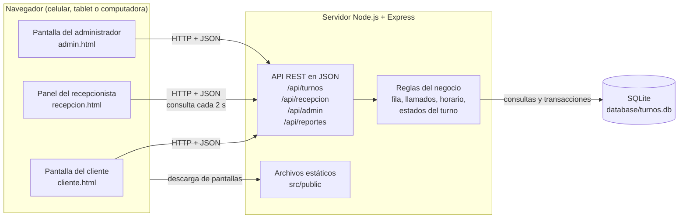

# Arquitectura seleccionada y justificación

Issue: GES-39 · Entregable: `docs/arquitectura.md`

Este documento explica la arquitectura elegida para el sistema de Gestión de Turnos, por qué es la adecuada para el problema y qué alternativas se descartaron. Sirve de base para los componentes y dependencias (GES-40) y para los modelos C4 (GES-41).

## 1. El problema

Un local de atención al cliente necesita ordenar su fila. Esto implica:

- Los **clientes** toman un turno desde su celular o desde una pantalla del local, sin crear cuenta y sin dar datos personales.
- Los **recepcionistas** llaman el siguiente turno desde su mostrador y marcan si el cliente fue atendido o no asistió.
- El **administrador** define servicios, mostradores y horarios, y consulta reportes.
- Todos ven la fila casi en tiempo real, aunque haya varios mostradores atendiendo a la vez.
- Un turno no se puede perder ni duplicar, y dos recepcionistas no pueden llamar al mismo turno.

Es un sistema de **un solo local**, con decenas de personas conectadas a la vez (la meta es soportar hasta 100 clientes simultáneos) y con pocos datos. No necesita escalar a miles de sucursales.

## 2. Arquitectura elegida

**Aplicación web cliente-servidor en capas**, con un único servidor y una base de datos local.

| Capa | Qué contiene | Tecnología | Dónde está |
|---|---|---|---|
| Presentación | Pantallas del cliente, del recepcionista y del administrador, que se ejecutan en el navegador | HTML, CSS y JavaScript estándar | `src/public/` |
| Aplicación (API) | Servidor que expone una API REST en JSON, aplica las reglas del negocio (orden de la fila, máximo de llamados, horario de atención, transiciones de estado) y sirve las pantallas | Node.js y Express | `src/server/` |
| Datos | Persistencia de turnos, llamados, servicios, mostradores, horarios y configuración | SQLite (`better-sqlite3`) | `database/schema.sql` y `src/server/db.js` |

### 2.1 Diagrama



### 2.2 Cómo fluye una petición

1. El navegador descarga la pantalla (HTML, CSS y JavaScript) desde el servidor.
2. El JavaScript de la pantalla llama a la API con `fetch` y recibe JSON.
3. La ruta de Express valida la petición y aplica las reglas del negocio (por ejemplo, que la atención esté abierta o que el turno esté `en_atencion`).
4. Las operaciones que cambian el estado se ejecutan dentro de una **transacción SQLite**, para que no queden datos a medias ni se repitan números.
5. El servidor responde con JSON, o con un error y un código claro (`FUERA_DE_HORARIO`, `FILA_VACIA`, etc.) que la pantalla convierte en un mensaje en español.

### 2.3 Estructura del código

```
src/public/              Pantallas y su JavaScript (capa de presentación)
src/server/app.js        Configuración de Express y montaje de rutas
src/server/routes/       Un módulo por área: turnos, recepcion, admin, reportes
src/server/horario.js    Regla de horario de atención compartida
src/server/db.js         Conexión a SQLite y carga del esquema
database/schema.sql      Esquema, datos de ejemplo y configuración
```

Cada área del servidor vive en su propio archivo de rutas, así el equipo puede trabajar en paralelo sin pisarse.

## 3. Por qué es la adecuada para este problema

- **Los usuarios no instalan nada.** Una aplicación web abre en cualquier celular o computadora con solo escribir una dirección. El cliente no tiene que descargar una app para tomar un turno.
- **La fila vive en un solo lugar.** Hay un único servidor y una única base de datos, así que todos ven la misma fila. No hay réplicas que se desincronicen ni conflictos entre sucursales.
- **Las reglas están en el servidor.** El orden de la fila, el máximo de llamados y el horario no dependen del navegador de nadie, por lo que no se pueden saltar desde la pantalla.
- **Es sencilla de mantener y de explicar.** Son tres capas con una sola tecnología de lenguaje (JavaScript) en el cliente y en el servidor, sin pasos de compilación. Es adecuada para el tamaño del equipo y el tiempo del curso.
- **La base de datos no necesita instalación.** SQLite es un archivo que se crea al iniciar el servidor, y cada integrante arranca el proyecto con `npm install` y `npm start`.

## 4. Alternativas consideradas

| Alternativa | Por qué se descartó |
|---|---|
| **Aplicación móvil o de escritorio nativa** | Obliga a instalar y a mantener versiones por plataforma. El cliente llega sin cuenta y sin preparación, así que abrir una página es mucho más directo. |
| **Aplicación de una sola página (React, Vue) con API separada** | Añade un proyecto más, un paso de compilación y más configuración. Las pantallas son pocas y simples, y HTML con JavaScript estándar basta. Además mantiene la compatibilidad con Chrome, Firefox y Edge (NFR-07) sin herramientas extra. |
| **Microservicios** | Hay un solo local, un equipo pequeño y pocas reglas. Dividir en servicios sumaría complejidad de red y despliegue sin ningún beneficio para este tamaño. |
| **Base de datos cliente-servidor (PostgreSQL, MySQL)** | Requiere instalar y administrar otro servidor. Para un solo local con pocos datos, SQLite en modo WAL ofrece transacciones y persistencia suficientes. Si el sistema creciera a varias sucursales, esta sería la primera pieza a cambiar. |
| **WebSockets o Server-Sent Events para tiempo real** | Dan actualizaciones inmediatas, pero necesitan conexiones abiertas y más código en el servidor. Con una consulta cada 2 segundos ya se cumple el requisito de actualización (NFR-02) y es más fácil de entender, probar y recuperar si se cae la conexión. |

## 5. Cómo responde la arquitectura a los requisitos clave

| Requisito | Cómo lo resuelve la arquitectura |
|---|---|
| **Actualización de la fila en 2 s (NFR-02)** | Las pantallas consultan la API con `fetch` cada 2 segundos (`setInterval`). Si falla la conexión, muestran un aviso claro y reintentan solas. |
| **Hasta 100 clientes simultáneos** | Cien pantallas consultando cada 2 segundos son unas 50 peticiones por segundo, que son lecturas cortas sobre SQLite. El servidor Node.js las atiende sin bloquearse. Es una estimación de diseño; se confirma con pruebas de carga (SC-001 de `specs/001-client-queue-flow/spec.md`). |
| **Números de turno únicos y sin condiciones de carrera (FR-013)** | El consecutivo del día se calcula dentro de una transacción de escritura y hay una restricción única `(fecha, numero)` en la base de datos. Llamar al siguiente turno también es una transacción, así que dos mostradores no se llevan el mismo turno. |
| **Persistencia y recuperación de errores (NFR-05)** | Todo el estado vive en SQLite y no en la memoria del servidor. Si el servidor se reinicia, los turnos siguen ahí. El modo WAL de SQLite mantiene la base consistente ante cierres inesperados, y los errores internos devuelven una respuesta controlada sin exponer detalles. |
| **Seguridad y privacidad (NFR-04)** | El sistema no guarda nombre, teléfono ni correo del cliente. Para cancelar, el cliente recibe un token privado y la base solo guarda su hash. Las contraseñas del personal se guardan solo como hash (`bcryptjs`). El acceso de recepcionistas y administradores se hará con sesión y rol. |
| **Disponibilidad y diseño responsive (NFR-03)** | La atención solo se acepta dentro de los horarios configurados, validados en el servidor, con un mensaje claro fuera de horario. Las pantallas usan CSS responsive para celular, tablet y computadora. |
| **Parámetros configurables (NFR-08)** | Valores como el máximo de llamados y los de la estimación están en la tabla `configuracion` y no en el código. |

## 6. Limitaciones y riesgos

- **Un solo servidor.** Si cae, el sistema no responde hasta reiniciarlo. Es aceptable para un solo local, y los datos no se pierden porque están en disco.
- **SQLite admite una escritura a la vez.** Para este volumen no es un problema, ya que las escrituras son cortas, pero no serviría para muchas sucursales escribiendo al mismo tiempo.
- **La actualización cada 2 s genera tráfico constante** mientras haya pantallas abiertas. Es poco con 100 usuarios, pero crece con el número de pantallas.
- **Sesiones de personal en el servidor.** El inicio de sesión de recepcionistas y administradores todavía no está implementado, así que por ahora el panel del recepcionista usa un selector de mostrador.

## 7. Evolución prevista

Si el proyecto creciera, el orden de cambios sería: pasar la base de datos a PostgreSQL, reemplazar la consulta periódica por Server-Sent Events y separar las reglas del negocio de las rutas en una capa de servicios. La arquitectura en capas permite hacerlo pieza por pieza, sin reescribir las pantallas.
