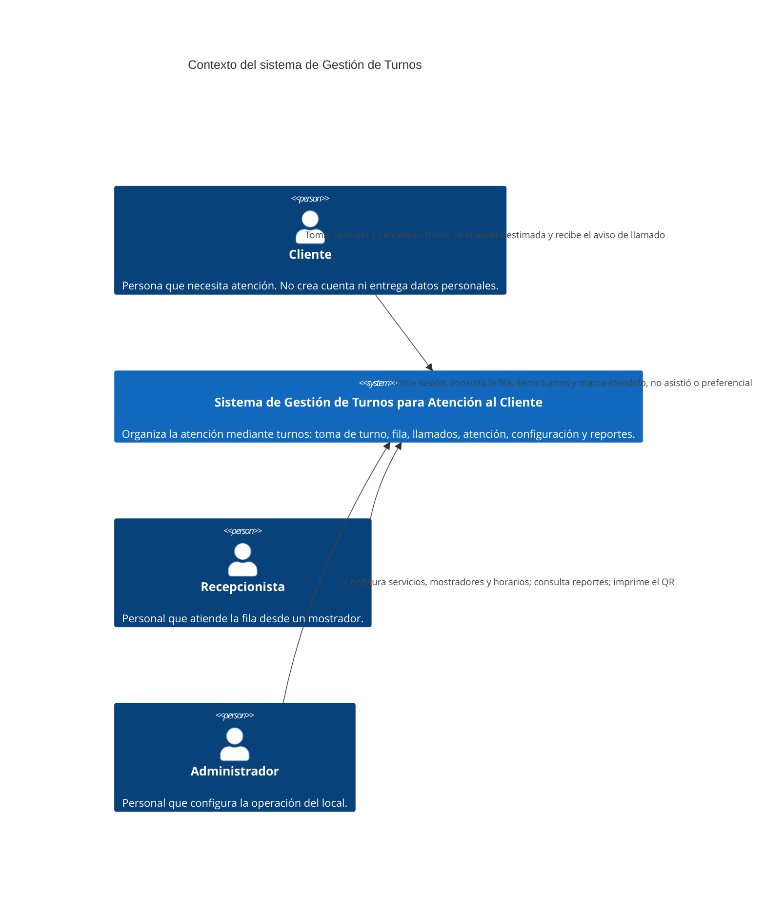
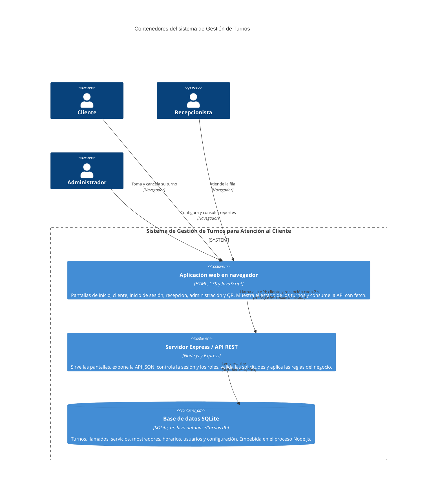
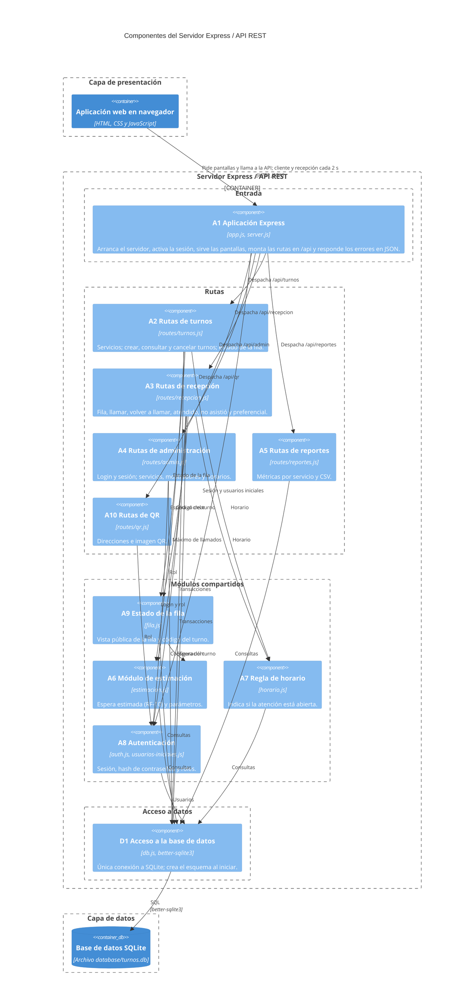

# Modelos C4 — Sistema de Gestión de Turnos para Atención al Cliente

Issue: GES-41 · Entregable: `docs/c4.md` · Se apoya en [`docs/arquitectura.md`](arquitectura.md) (GES-39) y [`docs/componentes.md`](componentes.md) (GES-40) · Actualizado el 24 de octubre de 2026 para reflejar el código actual

## 1. Introducción

El modelo C4 describe la arquitectura de un sistema de software en niveles de detalle creciente, como si se hiciera zoom sobre un mapa: primero el sistema y su entorno (contexto), después las piezas que se ejecutan por separado (contenedores) y finalmente los módulos internos de una de esas piezas (componentes).

Este documento presenta los tres primeros niveles para el sistema de Gestión de Turnos. El cuarto nivel (código) no se incluye porque el propio código, organizado en un archivo por módulo, ya cumple esa función. Los diagramas están escritos en Mermaid con notación C4 para que se mantengan como texto editable junto al código. Cada nivel descompone un elemento del nivel anterior: C2 abre el sistema de C1 y C3 abre el servidor Express de C2.

## 2. Arquitectura de referencia

GES-39 selecciona una **aplicación web cliente-servidor en tres capas**, con un único servidor y una base de datos local:

| Capa | Tecnología | Ubicación | Responsabilidad |
|---|---|---|---|
| Presentación | HTML, CSS y JavaScript estándar | `src/public/` | Pantallas del cliente, del recepcionista, del administrador, de inicio de sesión y del código QR, que se ejecutan en el navegador. |
| Aplicación | Node.js y Express (API REST en JSON) | `src/server/` | Atiende las peticiones HTTP, controla la sesión y los roles del personal, aplica las reglas del negocio (orden de la fila, máximo de llamados, horario, transiciones de estado) y sirve las pantallas. |
| Datos | SQLite con `better-sqlite3` | `database/schema.sql` y `src/server/db.js` | Persistencia de turnos, llamados, servicios, mostradores, horarios, usuarios y configuración. |

Las pantallas solo se comunican con la API mediante HTTP y JSON, las reglas del negocio viven en el servidor y las operaciones que cambian el estado de un turno se ejecutan en transacciones SQLite.

## 3. Modelo C1 — Contexto del sistema

**Objetivo:** mostrar el sistema como una sola caja, quiénes lo usan y para qué, sin detalles técnicos.

### 3.1 Explicación

El diagrama de contexto ubica al sistema dentro de su entorno. Hay un único sistema central y tres actores humanos, que corresponden a los roles del modelo de datos (`docs/modelo-de-datos.md`) y de los casos de uso (`docs/casos-de-uso.md`).

- **Cliente:** toma un turno para un servicio, consulta su estado, la fila y su espera estimada, recibe un aviso cuando lo llaman y puede cancelarlo mientras espera. No necesita cuenta; puede entrar escaneando el código QR del local.
- **Recepcionista:** inicia sesión, consulta la fila de su mostrador, llama al siguiente turno, repite el llamado, marca un turno como preferencial y registra si el cliente fue atendido o no asistió.
- **Administrador:** configura servicios, mostradores y horarios, consulta los reportes por servicio (y los descarga en CSV) e imprime el código QR. También puede usar el panel de recepción.

No se representan sistemas externos porque la solución no se integra con ninguno: todo el estado vive en la base de datos propia del sistema. Las tecnologías, la base de datos y la API quedan fuera de este nivel y aparecen en C2.

## 4. Modelo C2 — Contenedores

**Objetivo:** abrir el sistema de C1 y mostrar las piezas que se ejecutan por separado, su tecnología y cómo se comunican.

### 4.1 Tecnologías y responsabilidades

| Contenedor | Tecnología | Responsabilidad |
|---|---|---|
| Aplicación web en navegador | HTML, CSS y JavaScript sin frameworks | Presentar las pantallas, recibir las acciones del usuario, llamar a la API y mostrar estados y mensajes en español. Guarda en `localStorage` el turno del cliente (con su token de cancelación) y el mostrador elegido en recepción. |
| Servidor Express / API REST | Node.js y Express | Servir los archivos de `src/public/`, exponer las rutas `/api/turnos`, `/api/recepcion`, `/api/admin`, `/api/reportes` y `/api/qr`, controlar la sesión y el rol del personal, validar las peticiones, aplicar las reglas del negocio y responder en JSON con códigos de error claros. |
| Base de datos SQLite | SQLite mediante `better-sqlite3` | Guardar turnos, llamados, servicios, mostradores, horarios, usuarios y configuración, y conservarlos entre reinicios. |

### 4.2 Relaciones y protocolos

- **Navegador → Servidor Express:** el navegador descarga las pantallas como archivos estáticos y después su JavaScript llama a la API con `fetch` por HTTP, enviando y recibiendo JSON. La pantalla del cliente y el panel del recepcionista repiten la consulta cada 2 segundos. Las pantallas del personal envían la cookie de sesión (`httpOnly`) que crea el inicio de sesión. El servidor escucha en HTTP; el uso de HTTPS dependería del despliegue y no está configurado en el código.
- **Servidor Express → SQLite:** el servidor ejecuta consultas SQL de forma síncrona con `better-sqlite3`. Las operaciones que cambian el estado (crear, llamar, atender, no asistió, cambiar prioridad, guardar configuración) se agrupan en transacciones.

### 4.3 Explicación

Los tres contenedores implementan las tres capas de GES-39: el navegador es la capa de presentación, el servidor Express es la capa de aplicación y SQLite es la capa de datos.

SQLite no es un servidor de base de datos independiente: es una biblioteca embebida que el proceso Node.js usa para leer y escribir el archivo `database/turnos.db` (o el indicado en `DB_PATH`). Se representa como contenedor porque guarda los datos de forma separada y persistente, pero no existe comunicación por red entre el servidor y la base. Por eso, aunque el sistema tiene tres capas lógicas, en ejecución solo hay dos procesos: el navegador de cada usuario y el servidor Node.js.

## 5. Modelo C3 — Componentes

**Objetivo:** abrir el contenedor «Servidor Express / API REST» de C2 y mostrar sus componentes internos, qué hace cada uno y de cuáles depende. Los nombres e identificadores (A1 a A10, D1) son los de GES-40.

Dentro del servidor, los componentes se agrupan en cuatro niveles (entrada, rutas, módulos compartidos y acceso a datos) que siguen el orden de dependencias de GES-40. Esos grupos y los marcos «Capa de presentación» y «Capa de datos» solo ordenan el dibujo; no son contenedores nuevos.

### 5.1 Componentes identificados

| ID | Componente | Responsabilidad |
|---|---|---|
| A1 | Aplicación Express | Crea la aplicación, activa el lector de JSON y la sesión, crea los usuarios iniciales, sirve `src/public/`, monta las cinco rutas bajo `/api`, responde 404 en JSON para rutas inexistentes y maneja los errores (400 para solicitudes mal formadas, 500 sin detalles internos). `server.js` la pone a escuchar en el puerto configurado. |
| A2 | Rutas de turnos | `GET /servicios`, `POST /` (crea el turno con su número consecutivo del día dentro de una transacción y guarda la espera estimada), `GET /fila` (estado público de la fila), `GET /:id` y `PATCH /:id/cancelar` (con token privado cuyo hash se guarda en la base). |
| A3 | Rutas de recepción | `GET /fila`, `POST /llamar-siguiente`, `POST /turnos/:id/llamar`, `PATCH /turnos/:id/no-asistio`, `PATCH /turnos/:id/atendido` y `PATCH /turnos/:id/preferencial`. Exige rol de recepcionista o administrador, fija el mostrador del recepcionista, selecciona turnos compatibles con el mostrador, controla el máximo de llamados y calcula la duración de la atención. |
| A4 | Rutas de administración | `POST /login`, `POST /logout` y `GET /sesion` para todo el personal. Con rol de administrador: `GET/POST/PATCH /servicios`, `GET/POST/PATCH /mostradores` y `GET/PUT /horarios`, con validaciones y transacciones. |
| A5 | Rutas de reportes | `GET /` y `GET /csv`: total de turnos, espera promedio y duración promedio por servicio activo, con filtro opcional `desde`/`hasta`. |
| A6 | Módulo de estimación | `calcularEsperaEstimada` simula el reparto de la fila entre los mostradores activos compatibles usando la duración de cada servicio (promedio reciente o valor configurado). `leerConfiguracion` lee parámetros numéricos de la tabla `configuracion`. |
| A7 | Regla de horario | `atencionAbierta`, `horarioPublico` y `responderFueraDeHorario` sobre la tabla `horarios_atencion`. |
| A8 | Autenticación | `auth.js`: configuración de `express-session`, hash y verificación con `bcryptjs`, y los filtros `requiereLogin` y `requiereRol`. `usuarios-iniciales.js`: crea un administrador y dos recepcionistas si la tabla `usuarios` está vacía. |
| A9 | Estado de la fila | `estadoDeLaFila` devuelve los turnos en atención, la cantidad en espera por servicio y, si se indica un turno, cuántos van antes y su espera. `codigoTurno` genera el código visible (`C-001`). |
| A10 | Rutas de QR | `GET /direcciones` y `GET /imagen`: detecta las direcciones de red del servidor y genera el QR en SVG con el paquete `qrcode`. Exige rol de recepcionista o administrador. |
| D1 | Acceso a la base de datos | Abre la única conexión a SQLite, activa claves foráneas y el modo WAL, ejecuta `database/schema.sql` y agrega la columna `token_cancelacion_hash` en bases anteriores. |

### 5.2 Dependencias

Las dependencias del diagrama salen de los `require` y de las llamadas reales del código:

- `app.js` importa `auth.js` (sesión), `usuarios-iniciales.js` y las cinco rutas, y las monta con `app.use`, así que toda petición a `/api/...` entra por A1 y se despacha al router correspondiente. También importa `db.js` para la ruta de diagnóstico `/api/salud`; esa dependencia no se dibuja para no cruzar todo el diagrama.
- `routes/turnos.js` importa `db.js`, `estimacion.js`, `horario.js`, `fila.js` y el módulo `crypto` de Node.js. Llama a `calcularEsperaEstimada` dentro de la transacción que crea el turno.
- `routes/recepcion.js` importa `db.js`, `horario.js`, `auth.js`, `estimacion.js` (solo `leerConfiguracion`) y `fila.js` (solo `codigoTurno`).
- `routes/admin.js` importa `db.js` y `auth.js`.
- `routes/reportes.js` importa solo `db.js`.
- `routes/qr.js` importa `auth.js`, el paquete `qrcode` y el módulo `os` de Node.js.
- `fila.js` importa `db.js` y `estimacion.js`; `estimacion.js` y `horario.js` importan solo `db.js`; `usuarios-iniciales.js` importa `db.js` y `auth.js`.

### 5.3 Explicación

El servidor se organiza en un punto de entrada (A1), un módulo de rutas por área funcional (A2 a A5 y A10), módulos compartidos con reglas que usan varias rutas (A6 a A9) y un único punto de acceso a datos (D1). Las dependencias van en un solo sentido: las rutas usan los módulos compartidos y estos usan el acceso a datos; ningún componente inferior conoce a los superiores y las rutas no se llaman entre sí, tal como fijan las reglas de GES-40.

Las peticiones del navegador entran por A1, que sirve las pantallas y despacha cada llamada a la API según su prefijo: la pantalla del cliente termina en A2, el panel del recepcionista en A3 (y en A4 para conocer la sesión), el panel de administración en A4 y A5, la pantalla de inicio de sesión en A4 y la del código QR en A10.

GES-40 ubica D1 en la capa de datos. En C4, `db.js` se ejecuta dentro del proceso del servidor, así que se dibuja como componente del contenedor Express, mientras que el archivo SQLite es el contenedor de datos de C2. La responsabilidad es la misma; solo cambia el nivel en que se representa. Las tablas no se modelan como componentes porque son datos dentro del contenedor SQLite.

## 6. Correspondencia con la implementación

| Elemento C4 | Archivo o módulo | Responsabilidad |
|---|---|---|
| Sistema (C1) | Repositorio completo | Gestión de turnos para atención al cliente |
| Aplicación web en navegador (C2) | `src/public/index.html`, `cliente.html`, `login.html`, `recepcion.html`, `admin.html`, `qr.html`, `js/*.js`, `css/` | Pantallas y llamadas a la API |
| Servidor Express / API REST (C2) | `src/server/` | API REST, sesión, reglas del negocio y archivos estáticos |
| Base de datos SQLite (C2) | `database/turnos.db` (o `DB_PATH`), esquema en `database/schema.sql` | Persistencia |
| A1 Aplicación Express (C3) | `src/server/app.js`, `src/server/server.js` | Arranque, sesión, montaje de rutas y manejo de errores |
| A2 Rutas de turnos (C3) | `src/server/routes/turnos.js` | Servicios, creación, consulta, fila y cancelación de turnos |
| A3 Rutas de recepción (C3) | `src/server/routes/recepcion.js` | Fila, llamados, atendido, no asistió y prioridad |
| A4 Rutas de administración (C3) | `src/server/routes/admin.js` | Login y configuración de la operación |
| A5 Rutas de reportes (C3) | `src/server/routes/reportes.js` | Reportes de atención y CSV |
| A6 Módulo de estimación (C3) | `src/server/estimacion.js` | Espera estimada y parámetros |
| A7 Regla de horario (C3) | `src/server/horario.js` | Horario de atención |
| A8 Autenticación (C3) | `src/server/auth.js`, `src/server/usuarios-iniciales.js` | Sesión, contraseñas y roles |
| A9 Estado de la fila (C3) | `src/server/fila.js` | Vista pública de la fila |
| A10 Rutas de QR (C3) | `src/server/routes/qr.js` | Código QR de acceso |
| D1 Acceso a la base de datos (C3) | `src/server/db.js` | Conexión única, esquema y migración |

## 7. Coherencia arquitectónica

**Con GES-39 (arquitectura seleccionada).** C2 reproduce las tres capas elegidas: navegador (presentación), servidor Express (aplicación) y SQLite (datos). Se mantienen las decisiones del documento: un solo servidor, una sola base local, API REST en JSON, reglas en el servidor y consulta periódica en lugar de WebSockets. No se agrega ninguna tecnología ni contenedor que GES-39 no contemple.

**Con GES-40 (componentes, responsabilidades y dependencias).** C3 usa los mismos componentes de la capa de aplicación y de datos (A1 a A10 y D1), con sus nombres, responsabilidades y dependencias. Los componentes de presentación (P1 a P6) quedan agrupados en el contenedor «Aplicación web en navegador» de C2, porque C3 solo descompone el servidor.

**Con la implementación.** Cada componente de C3 corresponde a un archivo real y cada relación a un `require` o una llamada verificada en el código. Quedan estas observaciones:

- GES-39 muestra «Reglas del negocio» como un bloque separado de la API. En el código, y en GES-40, esas reglas están dentro de cada módulo de rutas y en los módulos compartidos (`horario.js`, `estimacion.js` y `fila.js`). C3 sigue la organización de GES-40. GES-39 menciona la separación en una capa de servicios como evolución futura.
- `routes/reportes.js` no usa A8, así que los reportes no exigen sesión de administrador. Se registra como pendiente en `componentes.md`.

## 8. Conclusión

Los tres modelos permiten entender el sistema de lo general a lo particular. C1 muestra quién usa el sistema y para qué, sin tecnicismos; C2 explica con qué tecnologías se construye y cómo viajan los datos entre el navegador, el servidor y la base; y C3 muestra cómo está organizado el servidor por dentro y qué depende de qué.

Esta vista facilita el mantenimiento y el trabajo en equipo: ubica rápidamente dónde debe hacerse un cambio y permite comprobar que las nuevas funciones respeten las reglas de dependencia antes de escribir código. Al estar en Mermaid, los diagramas se actualizan en el mismo repositorio y en el mismo Pull Request que el código que describen.

## 9. Referencias internas

- [`docs/arquitectura.md`](arquitectura.md) — GES-39, arquitectura seleccionada y justificación.
- [`docs/componentes.md`](componentes.md) — GES-40, componentes, responsabilidades y dependencias.
- [`docs/modelo-de-datos.md`](modelo-de-datos.md) — modelo de datos, estados y roles.
- [`docs/casos-de-uso.md`](casos-de-uso.md) — GES-38, actores y casos de uso.
- `database/schema.sql`, `package.json`, `src/server/` y `src/public/` — implementación revisada.
