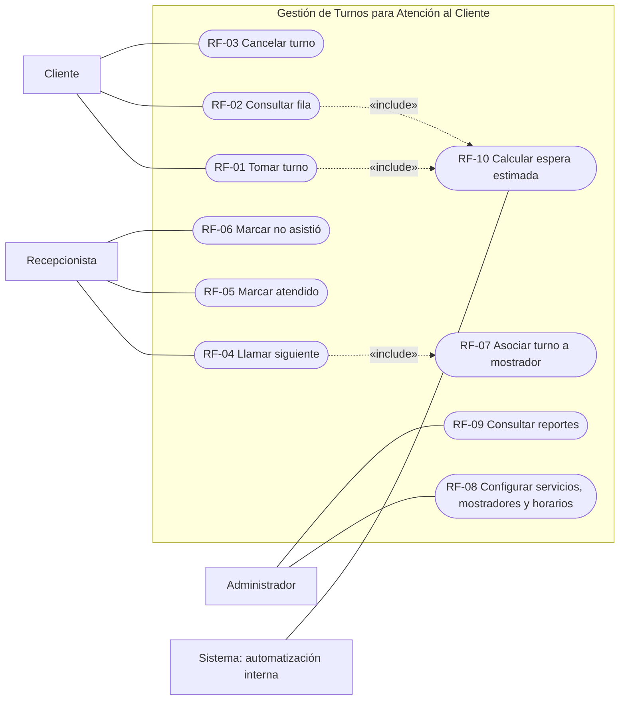
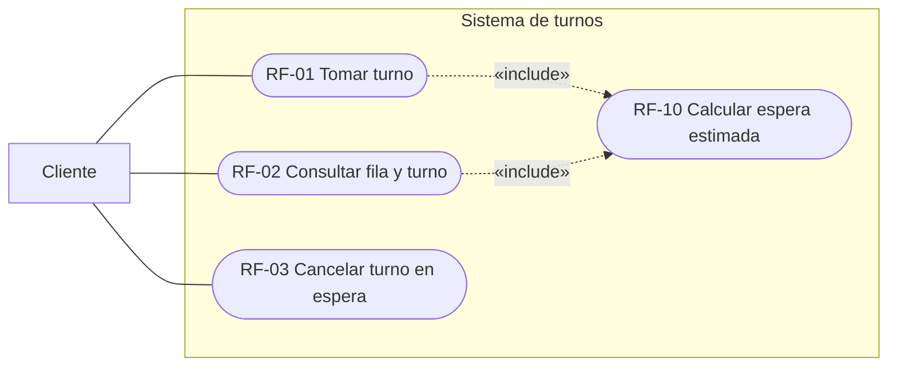
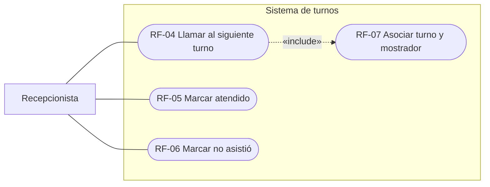
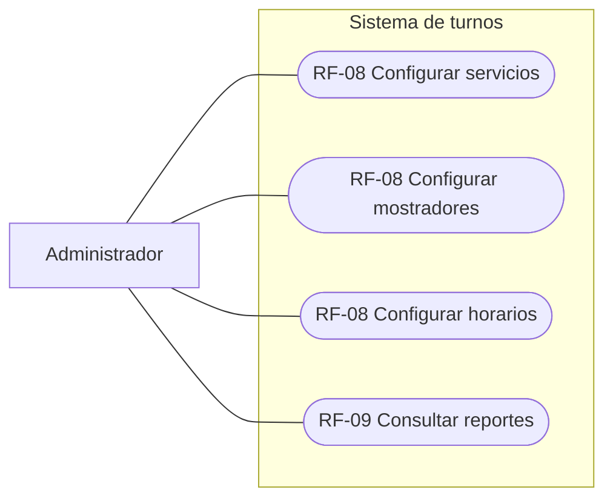
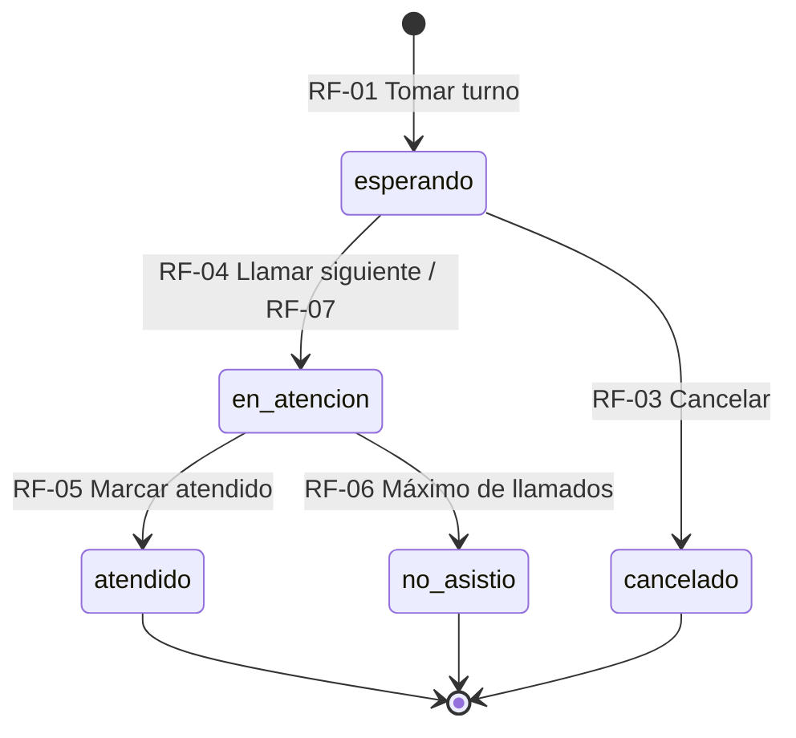

# GES-38 — Casos de uso: Gestión de Turnos para Atención al Cliente

> **Issue:** GES-38 · **Entregable:** `docs/casos-de-uso.md`  
> **Alcance:** análisis y diseño; este documento describe comportamiento esperado y **no confirma que los módulos ya estén implementados**.

## 1. Objetivo y alcance

Identificar los actores y describir las interacciones esenciales para tomar, consultar, cancelar, llamar y atender turnos, registrar ausencias, configurar la atención, consultar reportes y calcular la espera estimada. Esta entrega cubre RF-01 a RF-10, incluido **RF-07** por su relación directa con la llamada y asignación del mostrador.

**Fuentes de referencia:** guía del proyecto proporcionada por el equipo, [`docs/modelo-de-datos.md`](modelo-de-datos.md), [`database/schema.sql`](../database/schema.sql) y [`specs/001-client-queue-flow/spec.md`](../specs/001-client-queue-flow/spec.md). Los criterios de RF-01, RF-02 y RF-03 se apoyan en la especificación existente; para los demás casos se propone un nivel de detalle coherente con los requisitos asignados y el modelo de datos, pendiente de confirmación por sus responsables.

### 1.1 Actores

| Actor | Descripción | Autenticación |
|---|---|---|
| **Cliente** | Solicita y consulta un turno y puede cancelar su propio turno en espera. No se guardan datos personales. | Sin cuenta. |
| **Recepcionista** | Atiende la fila desde un mostrador: llama, registra la atención y marca ausencias. | Sesión con rol recepcionista (requisito previsto). |
| **Administrador** | Configura servicios, mostradores y horarios; consulta reportes. | Sesión con rol administrador (requisito previsto). |
| **Sistema (automatización)** | Rol lógico que ejecuta el cálculo de espera estimada por eventos de negocio. | No corresponde a un usuario autenticado. |

**Nota UML:** en UML estricto, el sistema completo no es actor externo de sí mismo. El nombre «Sistema (automatización)» aparece para respetar la consigna; representa una responsabilidad interna. En el diagrama se ubica como actor convencional únicamente con fines académicos, no como una API externa.

## 2. Diagrama UML general de casos de uso

**Archivo UML editable:** [`docs/diagramas/GES-38_Diagramas_de_casos_de_uso.drawio`](diagramas/GES-38_Diagramas_de_casos_de_uso.drawio) (contiene el diagrama general y vistas individuales por actor). A continuación se incluye una versión Mermaid autocontenida, usando `flowchart` y nodos elípticos porque Mermaid no dispone de una sintaxis `usecaseDiagram` estándar portable.

**Leyenda:** línea continua = asociación actor–caso de uso; `«include»` = comportamiento reutilizado que se ejecuta dentro del caso de uso base. Los vínculos de RF-01/RF-02 hacia RF-10 modelan la obtención de una estimación cuando se solicita o consulta un turno; no prescriben una fórmula específica. La asociación de RF-04 con RF-07 refleja que el mostrador se asigna cuando se llama el turno, no al crearlo.

### 2.1 Vista enfocada: Cliente

### 2.2 Vista enfocada: Recepcionista

### 2.3 Vista enfocada: Administrador

**Nota:** la vista de administrador separa RF-08 en tres operaciones independientes para facilitar la lectura; el diagrama general conserva el requerimiento agrupado.

## 3. Descripciones por caso de uso

### CU-01 — Tomar turno sin cuenta (RF-01)

- **Actor principal:** Cliente.
- **Objetivo:** obtener un número de turno para un servicio activo sin crear cuenta ni facilitar datos personales.
- **Precondiciones:** servicio activo; establecimiento dentro de horario; sistema y base de datos disponibles.
- **Flujo principal:**
  1. El cliente ingresa a la pantalla de toma de turnos.
  2. El sistema muestra los servicios activos y la disponibilidad de atención.
  3. El cliente selecciona un servicio y confirma la solicitud.
  4. El sistema valida el servicio y el horario de atención.
  5. El sistema genera de forma transaccional el consecutivo diario y registra el turno con estado `esperando`.
  6. El sistema muestra el número formado por prefijo y consecutivo (ejemplo: `T-012`) y, cuando corresponde, una estimación de espera.
- **Flujos alternativos:**
  - A1. Fuera de horario: se informa que la atención está cerrada; no se crea turno.
  - A2. No hay servicios activos o el elegido está inactivo: se rechaza la solicitud y se ofrece corregirla.
  - A3. Error de persistencia: se informa el error sin mostrar un turno no confirmado.
  - A4. Solicitud repetida o respuesta perdida: se previenen duplicados y se consulta el estado real antes de repetir la creación.
- **Resultado/postcondición:** existe un único turno confirmado en estado `esperando`, con identificador diario y sin datos personales del cliente.

### CU-02 — Consultar la fila y el estado del turno (RF-02)

- **Actor principal:** Cliente.
- **Objetivo:** conocer la posición, avance de la fila y estado del turno.
- **Precondiciones:** la pantalla de consulta está disponible; para consultar un turno propio debe existir su referencia.
- **Flujo principal:**
  1. El cliente accede a la consulta de la fila.
  2. El sistema obtiene los turnos `esperando` ordenados por prioridad (preferencial primero y luego consecutivo) y los `en_atencion` con su mostrador.
  3. Se presenta cuántos turnos hay delante del cliente y, si está disponible, la espera aproximada.
  4. Mientras la pantalla esté activa, el navegador intenta actualizar la información cada 2 segundos.
  5. Ante cambios, se actualizan estados y avisos; si el propio turno está `en_atencion`, se indica su mostrador.
- **Flujos alternativos:**
  - A1. Fila vacía: se muestra un mensaje informativo.
  - A2. Error temporal de red: se conserva la última información válida y se advierte que puede estar desactualizada.
  - A3. El turno está `atendido`, `no_asistio` o `cancelado`: se muestra su estado final sin situarlo en la fila pendiente.
- **Resultado/postcondición:** información de consulta visible sin alterar el estado de los turnos ni exponer datos personales.

### CU-03 — Cancelar turno (RF-03)

- **Actor principal:** Cliente.
- **Objetivo:** liberar un turno propio que aún no ha sido llamado.
- **Precondiciones:** el cliente conserva una referencia válida a su turno y el turno se encuentra en estado `esperando`.
- **Flujo principal:**
  1. El cliente visualiza su turno y selecciona **Cancelar**.
  2. El sistema solicita confirmación.
  3. El cliente confirma la acción.
  4. El servidor verifica la autorización sobre el turno y que todavía esté `esperando`.
  5. El estado cambia a `cancelado` mediante una operación consistente.
  6. El turno desaparece de la fila pendiente y se confirma la cancelación.
- **Flujos alternativos:**
  - A1. El cliente decide no confirmar: no ocurre ningún cambio.
  - A2. El turno ya está `en_atencion`, `atendido`, `no_asistio` o `cancelado`: se rechaza la operación.
  - A3. La referencia no corresponde al turno propio: se rechaza la cancelación.
  - A4. Cambio concurrente o error de comunicación: se consulta el estado real y no se revierte un estado final válido.
- **Resultado/postcondición:** el turno se marca `cancelado`, deja de contarse en la fila y el cliente puede solicitar otro.
- **Observación de diseño:** la especificación exige impedir cancelar turnos ajenos; el mecanismo concreto de titularidad todavía debe acordarse con el equipo.

### CU-04 — Llamar al siguiente turno (RF-04)

- **Actor principal:** Recepcionista.
- **Objetivo:** llamar al primer turno elegible para los servicios que atiende su mostrador.
- **Precondiciones:** sesión autorizada; recepcionista vinculado con un mostrador activo; existen turnos elegibles.
- **Flujo principal:**
  1. El recepcionista abre el panel y solicita llamar al siguiente turno.
  2. El sistema identifica su mostrador y los servicios habilitados.
  3. Selecciona el primer turno `esperando` del día compatible con el mostrador, primero `preferencial` y luego por número.
  4. Ejecuta RF-07 para asociar el mostrador y al recepcionista al turno.
  5. Cambia el turno a `en_atencion`, registra el llamado y la marca de tiempo pertinente conforme al modelo.
  6. Muestra el número y mostrador en las pantallas correspondientes.
- **Flujos alternativos:**
  - A1. No hay turnos elegibles: se informa al recepcionista sin modificar registros.
  - A2. El mostrador o usuario no está autorizado: la operación es rechazada.
  - A3. Llamadas concurrentes: la transacción impide que dos recepcionistas se asignen indebidamente el mismo turno.
  - A4. La operación falla: no debe registrarse una asignación parcial.
- **Resultado/postcondición:** el turno seleccionado queda en `en_atencion`, asociado al mostrador, con un llamado registrado.

### CU-05 — Marcar turno como atendido (RF-05)

- **Actor principal:** Recepcionista.
- **Objetivo:** cerrar una atención y registrar su duración.
- **Precondiciones:** sesión autorizada; turno del mostrador en estado `en_atencion`.
- **Flujo principal:**
  1. El recepcionista selecciona el turno que está atendiendo.
  2. Selecciona la opción **Marcar atendido**.
  3. El servidor valida el estado del turno y los permisos del usuario.
  4. Registra `fin_atencion` y calcula `duracion_seg` a partir del inicio registrado.
  5. Cambia el estado a `atendido` y confirma la operación.
- **Flujos alternativos:**
  - A1. Turno en otro estado o ya finalizado: se rechaza el cierre duplicado.
  - A2. Falta una marca de inicio válida: se rechaza o gestiona el error sin almacenar una duración inválida.
  - A3. Error SQL: se revierte la transacción, conservando el estado anterior.
- **Resultado/postcondición:** turno `atendido` y duración persistida para la consulta de reportes y estimaciones.
- **Regla del modelo actual:** `inicio_atencion` se registra en RF-04, cuando se llama el turno. Si el equipo desea medir solo atención efectiva, debe formalizar una decisión de diseño antes de cambiarla.

### CU-06 — Marcar no asistió después de los llamados (RF-06)

- **Actor principal:** Recepcionista.
- **Objetivo:** cerrar un turno al que el cliente no respondió después del máximo permitido de llamados.
- **Precondiciones:** turno en `en_atencion`; al menos un llamado registrado; sesión autorizada.
- **Flujo principal:**
  1. El recepcionista verifica que el cliente no se presentó.
  2. El sistema dispone del historial de llamados en la tabla `llamados`.
  3. Se repite el llamado, registrando cada intento, hasta alcanzar `max_llamados` (valor inicial: 3).
  4. El recepcionista confirma que el cliente no asistió.
  5. El sistema verifica nuevamente estado y cantidad de llamados; marca el turno `no_asistio`.
  6. Actualiza la información de la fila para permitir continuar la atención.
- **Flujos alternativos:**
  - A1. El cliente responde antes del máximo: no se marca ausencia y continúa la atención.
  - A2. No se alcanzó el máximo: se impide marcar ausencia y se ofrece realizar el llamado pendiente.
  - A3. El turno fue atendido o finalizado por otra operación: se rechaza un cambio inconsistente.
- **Resultado/postcondición:** estado `no_asistio` y evidencia de los llamados conservada en la base de datos.
- **Nota:** el intervalo entre llamados aún debe acordarse; la especificación solo fija un máximo configurable.

### CU-07 — Vincular el servicio y mostrador a cada turno (RF-07)

- **Actor principal:** Recepcionista, a través de RF-04.
- **Objetivo:** asignar cada turno llamado a un mostrador compatible con su servicio.
- **Precondiciones:** turno `esperando`; servicio y mostrador activos, relacionados mediante `mostrador_servicio`.
- **Flujo principal:**
  1. El sistema recupera `tipo_servicio_id` del turno seleccionado.
  2. Verifica el mostrador del usuario mediante `usuarios.mostrador_id`.
  3. Comprueba que la relación `mostrador_servicio` permita atender ese servicio.
  4. Al realizar RF-04, asigna `turnos.mostrador_id` y `turnos.atendido_por`.
  5. Confirma que la información del llamado coincida con el mostrador y usuario.
- **Flujos alternativos:**
  - A1. El mostrador no ofrece ese servicio: se rechaza la asignación y se busca otro turno elegible.
  - A2. No existe mostrador activo o asignado: no se realiza el llamado.
  - A3. Falla la operación: se revierten sus modificaciones asociadas.
- **Resultado/postcondición:** el turno llamado queda ligado a un mostrador compatible y a un recepcionista; un turno `esperando` mantiene `mostrador_id` sin asignar según el modelo.

### CU-08 — Configurar servicios, mostradores y horarios (RF-08)

- **Actor principal:** Administrador.
- **Objetivo:** mantener la configuración operativa del sistema.
- **Precondiciones:** sesión activa con rol administrador.
- **Flujo principal:**
  1. El administrador ingresa a configuración.
  2. Selecciona **Servicios**, **Mostradores** o **Horarios**.
  3. Consulta la configuración existente.
  4. Registra o modifica el elemento elegido y sus campos válidos.
  5. El sistema verifica restricciones y persistencia antes de confirmar.
  6. Se muestra la configuración actualizada.
- **Flujos alternativos:**
  - A1. Datos inválidos o repetidos: se informa el error sin guardar cambios.
  - A2. Usuario sin permisos: se deniega el acceso.
  - A3. Desactivación de servicio o mostrador: se preserva el historial mediante borrado lógico (`activo=0`), conforme al modelo.
  - A4. Falla de persistencia: se mantiene la configuración previa.
- **Resultado/postcondición:** servicios, mostradores u horarios actualizados en la base de datos sin romper referencias históricas.
- **Detalle de la vista UML:** administrar servicios, mostradores y horarios se representa como tres operaciones independientes del mismo RF-08.

### CU-09 — Consultar reportes (RF-09)

- **Actor principal:** Administrador.
- **Objetivo:** conocer resultados de la operación de atención.
- **Precondiciones:** sesión con rol administrador; módulo de reportes disponible.
- **Flujo principal:**
  1. El administrador accede al panel de reportes.
  2. El sistema consulta registros de turnos y, cuando corresponde, tipos de servicio y duraciones.
  3. Agrupa datos mediante consultas SQL y calcula indicadores de atención.
  4. Presenta la información en tablas legibles.
- **Flujos alternativos:**
  - A1. Sin registros: se muestra un resultado vacío sin errores.
  - A2. Consulta o base de datos no disponible: se comunica el error y no se presentan cifras falsas.
  - A3. Usuario sin privilegios: se deniega el acceso.
- **Resultado/postcondición:** se visualizan reportes sin modificar los turnos.
- **Pendiente de acuerdo:** filtros exactos e indicadores del reporte (por fecha, estado, servicio, duración, etc.) deben confirmar su alcance con GES-32.

### CU-10 — Calcular espera estimada (RF-10)

- **Actor lógico:** Sistema (automatización), disparado por RF-01 y RF-02.
- **Objetivo:** ofrecer al cliente una estimación aproximada y no garantizada del tiempo pendiente de espera.
- **Precondiciones:** datos del turno y del servicio disponibles; parámetros de configuración accesibles.
- **Flujo principal:**
  1. El sistema identifica el turno, servicio y los turnos precedentes según las reglas de prioridad.
  2. Obtiene la información histórica de duración de atención disponible para estimar el tiempo.
  3. Consulta los parámetros de configuración aplicables a la estimación.
  4. Calcula una estimación no negativa en segundos conforme al algoritmo definido por GES-28.
  5. Muestra el resultado como aproximación; cuando corresponda, registra `espera_estimada_seg`.
- **Flujos alternativos:**
  - A1. Historial insuficiente: se utiliza una duración de referencia configurada por tipo de servicio.
  - A2. Faltan datos esenciales: se comunica que la estimación no está disponible, sin inventar un valor.
  - A3. La fila cambia: una consulta posterior puede producir otra estimación.
- **Resultado/postcondición:** una estimación consultable o una indicación explícita de indisponibilidad; no se garantiza la hora exacta de atención.
- **Parámetros actuales del esquema:** `estimacion_muestras_min=5`, `estimacion_ventana_dias=7` y `tipos_servicio.duracion_estimada_min`. La fórmula final pertenece a GES-28 y no se presume implementada.

## 4. Reglas compartidas del dominio

1. Los únicos estados definidos en el modelo son: `esperando`, `en_atencion`, `atendido`, `no_asistio`, `cancelado`.
2. Las transiciones permitidas son: `esperando → en_atencion → atendido`, `esperando → cancelado`, `en_atencion → no_asistio` con el máximo de llamados.
3. Se respeta el orden de prioridad `preferencial` primero y después el número de turno dentro de la misma prioridad.
4. La numeración es única por par (`fecha`, `numero`) y se genera sin duplicaciones en operaciones simultáneas.
5. El cliente no necesita crear cuenta y no se almacenan nombre, teléfono ni correo en el registro del turno.
6. La asignación del mostrador ocurre cuando se llama al turno (`RF-04`/`RF-07`), no en el momento de tomarlo.
7. Las consultas son de solo lectura; el refresco mediante `fetch` no debe modificar turnos.
8. Los permisos y las restricciones de estado deben verificarse en el servidor, no solamente en las pantallas.

### 4.1 Diagrama complementario de estados

Este diagrama es de apoyo a los casos de uso; no introduce estados nuevos.

## 5. Matriz de trazabilidad (GES-38)

| Requisito | Caso de uso | Actor | Evidencia esperada |
|---|---|---|---|
| RF-01 | CU-01 | Cliente | Turno único y en espera |
| RF-02 | CU-02 | Cliente | Consulta y refresco de la fila |
| RF-03 | CU-03 | Cliente | Cancelación válida y cambio de estado |
| RF-04 | CU-04 | Recepcionista | Selección y llamado del siguiente turno |
| RF-05 | CU-05 | Recepcionista | Finalización y duración |
| RF-06 | CU-06 | Recepcionista | Registro de llamados y ausencia |
| RF-07 | CU-07 | Recepcionista / RF-04 | Relación turno–servicio–mostrador |
| RF-08 | CU-08 | Administrador | Configuración persistida |
| RF-09 | CU-09 | Administrador | Reportes consultables |
| RF-10 | CU-10 | Sistema (automatización) | Estimación mostrada o no disponible |

## 6. Criterios de revisión antes de cerrar GES-38

- [x] El diagrama general incluye los cuatro actores solicitados y los casos de uso principales.
- [x] Cada caso de uso tiene actor, precondiciones, flujo principal, flujos alternativos y resultado.
- [x] RF-07 se integra con RF-04 sin modificar el modelo vigente.
- [x] Los nombres de estados y las reglas de prioridad coinciden con `modelo-de-datos.md`.
- [ ] Se revisan con los responsables las partes pendientes de definir en RF-06, RF-09 y RF-10.
- [x] Los diagramas UML se pueden abrir y editar en draw.io; el Markdown visualiza los diagramas Mermaid en GitHub.

## 7. Notas para la integración

- La documentación está diseñada para copiarse como `docs/casos-de-uso.md`.
- El archivo `.drawio` se recomienda guardar en `docs/diagramas/GES-38_Diagramas_de_casos_de_uso.drawio`.
- Los PNG/SVG son opcionales para la entrega gráfica o exposición; en GitHub el Markdown es autosuficiente.
- La existencia de un caso de uso en este documento **no implica** que la funcionalidad ya esté completada en el código.
