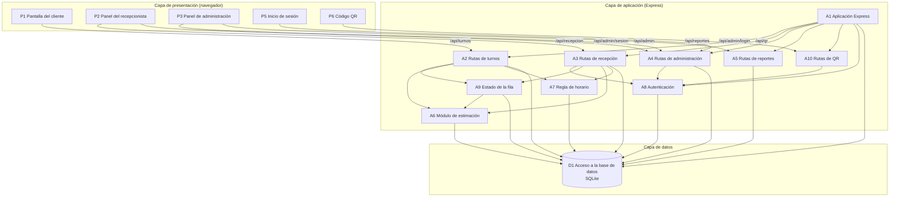

# Componentes, responsabilidades y dependencias

Issue: GES-40 · Entregable: `docs/componentes.md` · Se apoya en [`docs/arquitectura.md`](arquitectura.md) (GES-39) · Actualizado el 24 de octubre de 2026 para reflejar el código actual

Este documento descompone la arquitectura en capas en sus componentes principales, indica qué responsabilidad tiene cada uno y cómo se relacionan. Cada componente corresponde a archivos concretos de `src/public/` y `src/server/`. Es la base para los modelos C4 (GES-41).

## 1. Lista de componentes

Todos los componentes están implementados. La columna "Issue" indica dónde se construyeron o ampliaron.

### 1.1 Capa de presentación (`src/public/`)

| ID | Componente | Archivos | Responsabilidad | Issue |
|---|---|---|---|---|
| P1 | Pantalla del cliente | `cliente.html`, `js/cliente.js`, `css/cliente.css` | Permite elegir un servicio, tomar turno sin cuenta, ver el estado del turno y de la fila cada 2 segundos, recibir el aviso cuando lo llaman (sonido, vibración y título parpadeante) y cancelar el turno. | GES-15, GES-16, GES-27, GES-51 |
| P2 | Panel del recepcionista | `recepcion.html`, `js/recepcion.js`, `css/recepcion.css` | Muestra la fila del mostrador cada 2 segundos, el turno en atención y los otros mostradores. Permite llamar al siguiente, volver a llamar, marcar atendido o no asistió y marcar o quitar la prioridad preferencial. | GES-10, GES-18, GES-24, GES-50 |
| P3 | Panel de administración | `admin.html`, `js/admin.js` | Permite crear, editar, activar y desactivar servicios y mostradores, definir los horarios de atención y consultar los reportes con filtro de fechas y descarga en CSV. | GES-7, GES-32 |
| P4 | Página de inicio y estilos compartidos | `index.html`, `css/estilos.css` | Punto de entrada que lleva a cada pantalla, y estilos responsive comunes a todas. | GES-48, GES-18 |
| P5 | Inicio de sesión | `login.html`, `js/login.js` | Formulario de acceso del personal. Envía a cada usuario a su pantalla según su rol. | GES-8 |
| P6 | Código QR | `qr.html`, `js/qr.js` | Muestra e imprime un código QR con la dirección de la pantalla del cliente, para que la escaneen en el local. | GES-49 |

### 1.2 Capa de aplicación (`src/server/`)

| ID | Componente | Archivos | Responsabilidad | Issue |
|---|---|---|---|---|
| A1 | Aplicación Express | `app.js`, `server.js` | Arranca el servidor, activa la sesión, crea los usuarios iniciales, sirve las pantallas, monta las rutas bajo `/api` y responde los errores en JSON. | GES-48 |
| A2 | Rutas de turnos | `routes/turnos.js` | Lista los servicios, crea turnos con número consecutivo del día, entrega el estado de la fila, consulta un turno y lo cancela con un token privado. | GES-15, GES-16, GES-27 |
| A3 | Rutas de recepción | `routes/recepcion.js` | Entrega la fila de un mostrador, llama al siguiente turno, registra los llamados, marca atendido o no asistió y cambia la prioridad de un turno en espera. Solo para recepcionistas y administradores. | GES-10, GES-24, GES-50 |
| A4 | Rutas de administración | `routes/admin.js` | Inicio y cierre de sesión, consulta de la sesión actual, y gestión de servicios, mostradores y horarios (solo administradores). | GES-7, GES-8 |
| A5 | Rutas de reportes | `routes/reportes.js` | Total de turnos, espera promedio y duración promedio por servicio, con filtro opcional de fechas y exportación a CSV. | GES-48 (archivo), GES-32 (lógica) |
| A6 | Módulo de estimación | `estimacion.js` | Calcula la espera estimada de un turno según la duración de los servicios, la fila y los mostradores activos. También lee los parámetros numéricos de la tabla `configuracion`. | GES-28 |
| A7 | Regla de horario | `horario.js` | Dice si la atención está abierta, devuelve el horario de hoy y genera la respuesta estándar de "fuera de horario". | GES-10 |
| A8 | Autenticación | `auth.js`, `usuarios-iniciales.js` | Configura la sesión, guarda y verifica contraseñas con hash, protege rutas por rol y crea los usuarios iniciales si la base está vacía. | GES-8 |
| A9 | Estado de la fila | `fila.js` | Arma la vista pública de la fila: turnos en atención, cantidad en espera por servicio, turnos delante del cliente y su espera. También genera el código del turno (`C-001`). | GES-16 |
| A10 | Rutas de QR | `routes/qr.js` | Detecta las direcciones de red del servidor y genera la imagen QR de la pantalla del cliente. Solo para el personal. | GES-49 |

### 1.3 Capa de datos

| ID | Componente | Archivos | Responsabilidad |
|---|---|---|---|
| D1 | Acceso a la base de datos | `src/server/db.js`, `database/schema.sql` | Abre la conexión a SQLite, activa las claves foráneas y el modo WAL, crea las tablas, carga los datos de ejemplo y la configuración, y agrega la columna `token_cancelacion_hash` en bases anteriores. Es el único punto de acceso a la base. |

## 2. Diagrama de dependencias

Una flecha de A hacia B significa que **A usa a B**.

## 3. Dependencias en detalle

| Componente | Depende de | Para qué |
|---|---|---|
| P1 Pantalla del cliente | A2 | Obtener servicios, tomar turno, consultar la fila cada 2 segundos y cancelar el turno. |
| P2 Panel del recepcionista | A3 y A4 | Consultar la fila cada 2 segundos, ejecutar las acciones de llamado y conocer la sesión y el rol del usuario. |
| P3 Panel de administración | A4 y A5 | Configurar servicios, mostradores y horarios, y consultar o descargar reportes. |
| P5 Inicio de sesión | A4 | Enviar usuario y contraseña. |
| P6 Código QR | A10 | Obtener las direcciones y la imagen QR. |
| A1 Aplicación Express | A2, A3, A4, A5, A10, A8 y D1 | Montar cada ruta, activar la sesión, crear los usuarios iniciales y comprobar la base en `/api/salud`. |
| A2 Rutas de turnos | A9, A6, A7 y D1 | Calcular la espera al crear el turno, entregar el estado de la fila, validar el horario y guardar o leer turnos. |
| A3 Rutas de recepción | A8, A9, A6, A7 y D1 | Exigir el rol del personal, generar el código del turno, leer el máximo de llamados, bloquear llamados fuera de horario y mover los turnos entre estados dentro de transacciones. |
| A4 Rutas de administración | A8 y D1 | Verificar contraseñas, exigir el rol de administrador y guardar la configuración. |
| A5 Rutas de reportes | D1 | Consultar los turnos agrupados por servicio. |
| A10 Rutas de QR | A8 | Exigir el rol del personal. Usa además el paquete `qrcode`. |
| A9 Estado de la fila | A6 y D1 | Calcular la espera del turno consultado y leer la fila. |
| A6 Módulo de estimación | D1 | Leer turnos atendidos, duración de los servicios y parámetros de `configuracion`. |
| A7 Regla de horario | D1 | Leer la tabla `horarios_atencion`. |
| A8 Autenticación | D1 | Crear los usuarios iniciales con su contraseña guardada como hash. |

### 3.1 Dependencias externas

| Paquete | Usado por | Para qué |
|---|---|---|
| `express` | A1 y todas las rutas | Servidor web y API REST. |
| `better-sqlite3` | D1 | Conexión síncrona a SQLite y transacciones. |
| `express-session` | A8 | Mantener la sesión del personal con una cookie `httpOnly`. |
| `bcryptjs` | A8 | Guardar y verificar contraseñas como hash. |
| `qrcode` | A10 | Generar la imagen QR en formato SVG. |
| `crypto` (Node.js) | A2 | Generar el token de cancelación y guardar solo su hash. |
| `os` (Node.js) | A10 | Detectar las direcciones de red del servidor. |

## 4. Reglas de dependencia

Estas reglas mantienen el orden entre las capas y permiten que el equipo trabaje en paralelo. El código actual las cumple:

1. **Las pantallas solo hablan con la API.** Un componente de presentación nunca accede a la base de datos ni a archivos del servidor; todo pasa por HTTP y JSON.
2. **Las rutas no se llaman entre sí.** Si dos rutas necesitan la misma regla, esa regla vive en un módulo compartido (`horario.js`, `estimacion.js`, `fila.js` o `auth.js`).
3. **Solo `db.js` abre la base de datos.** Los demás componentes importan esa conexión y no crean otra.
4. **Las dependencias van hacia abajo:** presentación, luego rutas, luego módulos compartidos y por último la base de datos. Ningún componente de abajo conoce a los de arriba.
5. **Cada ruta vive en su propio archivo,** así cada integrante modifica su módulo sin pisar el de los demás.

## 5. Pendientes que afectan a los componentes

- **A5 Rutas de reportes:** no exigen sesión de administrador. Cualquier persona que conozca la dirección puede consultar las métricas o descargar el CSV. Para protegerlas basta con agregar `requiereRol('administrador')` y ajustar `tests/reportes.test.js` y `tests/Reportesfiltro.test.js`.
- **A3 Rutas de recepción:** no guardan qué usuario llamó o atendió cada turno (`turnos.atendido_por` y `llamados.usuario_id` quedan vacíos), aunque el dato está disponible en la sesión.
