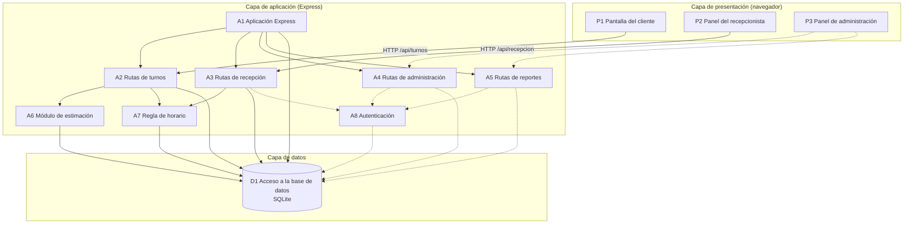

# Componentes, responsabilidades y dependencias

Issue: GES-40 · Entregable: `docs/componentes.md` · Se apoya en [`docs/arquitectura.md`](arquitectura.md) (GES-39)

Este documento descompone la arquitectura en capas en sus componentes principales, indica qué responsabilidad tiene cada uno y cómo se relacionan. Cada componente corresponde a archivos concretos de `src/public/` y `src/server/`. Es la base para los modelos C4 (GES-41).

## 1. Lista de componentes

El estado indica si el componente ya existe en el código o si está previsto.

### 1.1 Capa de presentación (`src/public/`)

| ID | Componente | Archivos | Responsabilidad | Estado |
|---|---|---|---|---|
| P1 | Pantalla del cliente | `cliente.html`, `js/cliente.js`, `css/cliente.css` | Permite al cliente elegir un servicio, tomar turno sin cuenta, ver el estado de su turno y cancelarlo. | Implementado |
| P2 | Panel del recepcionista | `recepcion.html`, `js/recepcion.js` | Muestra la fila, el turno en atención y los otros mostradores, y permite llamar, volver a llamar y marcar atendido o no asistió. | Implementado |
| P3 | Panel de administración | `admin.html` | Permitirá configurar servicios, mostradores y horarios, y consultar reportes. | Pantalla en construcción |
| P4 | Página de inicio y estilos compartidos | `index.html`, `css/estilos.css` | Punto de entrada que lleva a cada pantalla, y estilos responsive comunes a todas. | Implementado |

### 1.2 Capa de aplicación (`src/server/`)

| ID | Componente | Archivos | Responsabilidad | Estado |
|---|---|---|---|---|
| A1 | Aplicación Express | `app.js`, `server.js` | Arranca el servidor, sirve las pantallas, monta las rutas bajo `/api` y responde los errores en JSON. | Implementado |
| A2 | Rutas de turnos | `routes/turnos.js` | Lista los servicios, crea turnos con número consecutivo del día, consulta un turno y lo cancela con un token privado. | Implementado |
| A3 | Rutas de recepción | `routes/recepcion.js` | Entrega la fila de un mostrador, llama al siguiente turno, registra los llamados y marca atendido o no asistió. | Implementado |
| A4 | Rutas de administración | `routes/admin.js` | Gestionará servicios, mostradores y horarios. | Archivo creado, sin lógica |
| A5 | Rutas de reportes | `routes/reportes.js` | Entregará los datos de los reportes de atención. | Archivo creado, sin lógica |
| A6 | Módulo de estimación | `estimacion.js` | Calcula la espera estimada de un turno según la duración de los servicios y la fila. El resultado es una referencia, no una promesa. | Implementado |
| A7 | Regla de horario | `horario.js` | Dice si la atención está abierta ahora y devuelve el horario de hoy. Lo usan las rutas que deben bloquear acciones fuera de horario. | Implementado |
| A8 | Autenticación | (por crear) | Iniciará sesión de recepcionistas y administradores, verificará su rol y protegerá las rutas del personal. | Previsto |

### 1.3 Capa de datos

| ID | Componente | Archivos | Responsabilidad | Estado |
|---|---|---|---|---|
| D1 | Acceso a la base de datos | `src/server/db.js`, `database/schema.sql` | Abre la conexión a SQLite, activa las claves foráneas, crea las tablas y carga los datos de ejemplo y la configuración al iniciar. Es el único punto de acceso a la base. | Implementado |

## 2. Diagrama de dependencias

Una flecha de A hacia B significa que **A usa a B**. Las flechas punteadas son dependencias previstas que aún no existen en el código.

## 3. Dependencias en detalle

| Componente | Depende de | Para qué |
|---|---|---|
| P1 Pantalla del cliente | A2 Rutas de turnos | Obtener servicios, tomar turno, consultar su estado y cancelarlo. |
| P2 Panel del recepcionista | A3 Rutas de recepción | Consultar la fila cada 2 segundos y ejecutar las acciones de llamado. |
| P3 Panel de administración | A4 y A5 (previsto) | Configurar la atención y ver reportes. |
| A1 Aplicación Express | A2, A3, A4, A5 y D1 | Montar cada ruta y comprobar la base en `/api/salud`. |
| A2 Rutas de turnos | A6, A7 y D1 | Calcular la espera al crear el turno, validar el horario y guardar o leer turnos. |
| A3 Rutas de recepción | A7 y D1 | Bloquear llamados fuera de horario y mover los turnos entre estados dentro de transacciones. |
| A3, A4 y A5 | A8 (previsto) | Exigir sesión y rol antes de atender peticiones del personal. |
| A4 y A5 | D1 (previsto) | Leer y escribir configuración y consultar datos para reportes. |
| A6 Módulo de estimación | D1 | Leer turnos atendidos, duración de los servicios y parámetros de la tabla `configuracion`. |
| A7 Regla de horario | D1 | Leer la tabla `horarios_atencion`. |
| A8 Autenticación (previsto) | D1 | Leer usuarios y sus contraseñas guardadas como hash. |

### 3.1 Dependencias externas

| Paquete | Usado por | Para qué |
|---|---|---|
| `express` | A1 y todas las rutas | Servidor web y API REST. |
| `better-sqlite3` | D1 | Conexión síncrona a SQLite y transacciones. |
| `crypto` (Node.js) | A2 | Generar el token de cancelación y guardar solo su hash. |
| `bcryptjs` y `express-session` | A8 (previsto) | Guardar contraseñas como hash y mantener la sesión. Ya están instalados, pero todavía no se usan. |

## 4. Reglas de dependencia

Estas reglas mantienen el orden entre las capas y permiten que el equipo trabaje en paralelo:

1. **Las pantallas solo hablan con la API.** Un componente de presentación nunca accede a la base de datos ni a archivos del servidor; todo pasa por HTTP y JSON.
2. **Las rutas no se llaman entre sí.** Si dos rutas necesitan la misma regla, esa regla vive en un módulo compartido, como `horario.js` y `estimacion.js`.
3. **Solo `db.js` abre la base de datos.** Los demás componentes importan esa conexión y no crean otra.
4. **Las dependencias van hacia abajo:** presentación, luego rutas, luego módulos compartidos y por último la base de datos. Ningún componente de abajo conoce a los de arriba.
5. **Cada ruta vive en su propio archivo,** así cada integrante modifica su módulo sin pisar el de los demás.

## 5. Pendientes que afectan a los componentes

- **A8 Autenticación:** hasta que exista, el panel del recepcionista usa un selector de mostrador y las rutas de recepción no verifican quién llama.
- **P3, A4 y A5:** la administración y los reportes tienen el archivo creado pero sin comportamiento.
- Cuando se agreguen estos componentes, hay que actualizar este documento y el diagrama.
